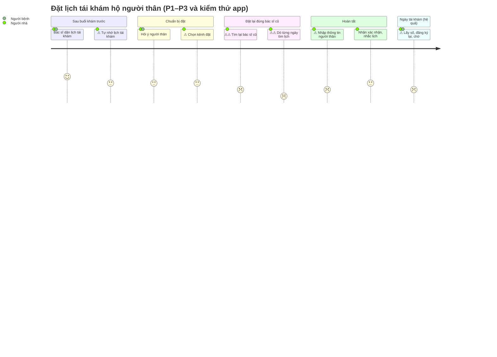
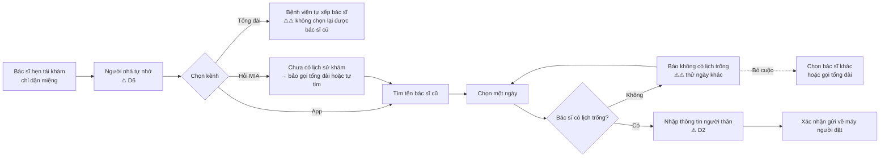

# Bản đồ hành trình (Journey Map)

Đặt lịch tái khám hộ người thân

| Thông tin tài liệu | |
|---|---|
| Dự án | Vinmec Exploration Sprint · Bài tập 1 tuần |
| Phạm vi | Từ khi bác sĩ hẹn tái khám ở buổi khám trước đến khi đặt xong lịch tái khám. Ngày tái khám chỉ để thể hiện hệ quả |
| Nhân vật | Người nhà (25–40 tuổi) đặt lịch tái khám hộ bố, mẹ hoặc ông bà |
| Dữ liệu đầu vào | Phỏng vấn P1–P3 (`../01-phong-van/phong-van/`), kiểm thử ứng dụng MyVinmec và chatbot MIA trong ứng dụng (`../01-phong-van/myvinmec-trial.md`) |
| Tệp hình | `journey-map.png`, `pain-workflow.png` |
| Phiên bản · Ngày | 1.0 · 19/10/2026 |
| Thuật ngữ | Xem `../THUAT-NGU.md` |

---

## Tóm tắt

Journey map (sơ đồ hành trình) mô tả 9 bước của người nhà khi đặt lịch tái khám hộ người thân, kèm cảm xúc, điểm đau và bằng chứng ở từng bước. Cảm xúc xuống thấp nhất ở bước 5–6, lúc người nhà tìm lại bác sĩ cũ rồi tìm lịch trống của bác sĩ đó. Hai bước này ứng với điểm đau chính D1. Chỉ bước 5 và 9 có điểm do người tham gia tự chấm.

---

## 1. Sơ đồ cảm xúc

Thang cảm xúc: 5 là dễ chịu, 1 là rất khó chịu.

- Bước có số liệu thật: điểm cảm xúc được quy đổi từ điểm khó chịu ở câu 1b theo công thức `6 − điểm khó chịu`. Ví dụ P1 chấm tái khám khó chịu 5/5 thì cảm xúc là 1.
- Các bước còn lại là ước lượng từ lời kể, ghi ƯL (ước lượng) trong bảng ở mục 2.
- ⚠ là điểm đau, ⚠⚠ là điểm đau chính. Nhãn trong sơ đồ được rút gọn, mô tả đầy đủ ở mục 2.

## 2. Chi tiết từng bước

⚠ là điểm đau, ⚠⚠ là điểm đau chính và là đầu vào cho need statement. Mã P#-Câu chỉ câu trả lời của một người, ví dụ P2-1b là câu 1b của P2. TN là trải nghiệm thật, YK là ý kiến.

| # | Bước | Hành động | Suy nghĩ hoặc trích dẫn | Cảm xúc (1–5) | Điểm đau | Bằng chứng |
|---|---|---|---|---|---|---|
| 1 | Bác sĩ dặn lịch tái khám | Nghe bác sĩ hẹn tái khám, thường chỉ dặn miệng | "Bác sĩ dặn lịch tái khám nhưng mình phải tự nhớ để đặt lại" | 4 (ƯL) | — | P2-1b |
| 2 | Tự nhớ lịch | Ghi nhớ trong vài tuần đến vài tháng. Người bệnh lớn tuổi thường dựa vào con cháu | "App nên tự nhắc lịch tái khám vì người lớn tuổi rất dễ quên" *(ý kiến)* | 3 (ƯL) | ⚠ D6 Phải tự nhớ lịch tái khám | P2-1b (TN). P1-12, P2-13 (YK). App: MIA nói chỉ nhắc lịch đã đặt qua app hoặc website, không nhắc theo hẹn của bác sĩ (M4) |
| 3 | Hỏi ý người thân | Hỏi ngày giờ người thân đi được, sắp xếp người đi cùng, xin nghỉ làm | "Phải hỏi ý ông về ngày giờ, sắp xếp đi cùng, vì ông đi một mình không tiện" | 3 (ƯL) | — | P2-8, P2-7 |
| 4 | Chọn kênh đặt | P1 gọi tổng đài. P2 dùng app, có bác sĩ quen hướng dẫn. P3 gọi điện hỏi rồi đến thẳng | Tin người hơn app: "không phải ai cũng có bác sĩ quen giúp như gia đình mình" | 3 (ƯL) | ⚠ D5 Tin người hơn app | P1-10, P1-11, P2-10, P2-13, P3-1 |
| 5 | Tìm lại bác sĩ cũ | Tổng đài: bệnh viện tự sắp xếp. App: tìm theo tên bác sĩ, hồ sơ ít thông tin. MIA: chưa có lịch sử khám thì chỉ hướng dẫn tự tìm | P1: "không được chủ động lựa chọn lại bác sĩ đã khám… lần đầu". P2: "Thôi mình chọn bác sĩ đầu tiên cho nhanh" | 1 (P1: tái khám khó chịu 5/5). 2–3 (P2: đặt lịch khó chịu 2/5, tự làm thì 3–4) | ⚠⚠ **D1** Không chủ động đặt lại được bác sĩ cũ | P1-1b, P1-3, P2-4, P2-11, P2-11b. App: IMG_4761 (hồ sơ bác sĩ lỗi). MIA: M1, M2 |
| 6 | Tìm lịch trống của bác sĩ đó | App chỉ cho chọn từng ngày. Gặp ngày kín thì báo "không có lịch trống" và phải thử ngày khác. Hỏi MIA về lịch thì MIA không trả lời được | P2: "không biết ai phù hợp và ai còn lịch gần". Người thử: "không thể biết được bác sĩ muốn đặt có lịch trống khi nào, mất thời gian trong việc tìm lịch" | 1 (ƯL, điểm thấp nhất) | ⚠⚠ D1 (tiếp). Không thấy lịch trống, phải dò từng ngày | P2-11. App: IMG_4760. MIA: M1 (không đưa lịch trống), M7 (từ chối câu hỏi về lịch) |
| 7 | Nhập thông tin | Nhập ngày sinh, BHYT, CCCD của người thân. App bắt buộc ô "Lý do khám" và yêu cầu "mô tả rõ triệu chứng" | "Bước lâu nhất là nhập thông tin của ông, phải xem lại giấy tờ, số BHYT, ngày sinh" | 2 (ƯL) | ⚠ D2 Hệ thống chỉ nhận một người | P2-5, P2-8, P1-6. App: IMG_4760. MIA: M3 |
| 8 | Xác nhận và nhắc lịch | App gửi thông báo về máy người đặt. Tổng đài đưa mã đăng ký nhưng không có giờ cụ thể | "Thông báo thì gửi về số của mình mà hồ sơ lại là của ông nên dễ nhầm" | 3 (ƯL) | ⚠ D2, D3 | P2-6, P2-8, P1-6 |
| 9 | Ngày tái khám *(ngoài phạm vi)* | Đến nơi vẫn lấy số, đăng ký lại, chờ. Đến muộn có thể chờ tới cuối ngày | P3: "không biết chính xác khi nào đến lượt" | 2–3 (P2: check-in và chờ khó chịu 3/5). 2 (P3: chờ là khâu tệ nhất) | ⚠ D3, D4 (vận hành bệnh viện, chỉ ghi nhận) | P1-7, P2-7, P2-1b, P3-1b |

## 3. Điểm đau chính: bước 5–6

Cảm xúc thấp nhất ở bước 5–6. Người nhà biết mình muốn tái khám với đúng bác sĩ cũ, nhưng không kênh nào cho thấy bác sĩ đó trống lịch khi nào. Họ phải dò từng ngày trên app, để tổng đài tự xếp bác sĩ, hoặc chọn đại một bác sĩ khác ("chọn bác sĩ đầu tiên cho nhanh").

Need statement tương ứng (chi tiết ở `../03-need-statement/need-statement.md`):

> *Cách để giảm thời gian và số lần thao tác cần thiết để đặt lịch tái khám với đúng bác sĩ đang theo dõi người bệnh, cho người nhà đặt lịch hộ người thân (cha mẹ, ông bà), trong bối cảnh không biết bác sĩ đó còn trống lịch vào ngày nào, phải dò từng ngày hoặc chấp nhận một bác sĩ khác.*

## 4. Giới hạn

- Điểm cảm xúc có số liệu thật chỉ ở bước 5 và bước 9 (lấy từ câu 1b). Các bước khác là ước lượng từ lời kể.
- P3 chấm câu 1b theo thang ngược (thang thuận tiện) và lần khám gần nhất là đến thẳng, không phải tái khám, nên P3 chỉ đóng góp ở bước 4 và 9.
- Bước 6 mới có số liệu kiểm thử với 1 bác sĩ, chưa có số lần thử và thời gian. Cần đo bổ sung để đưa lên slide.
- Mẫu n=3 (3 người), cả 3 đều đặt hộ người thân. Journey này không đại diện cho người tự đặt lịch cho mình.
