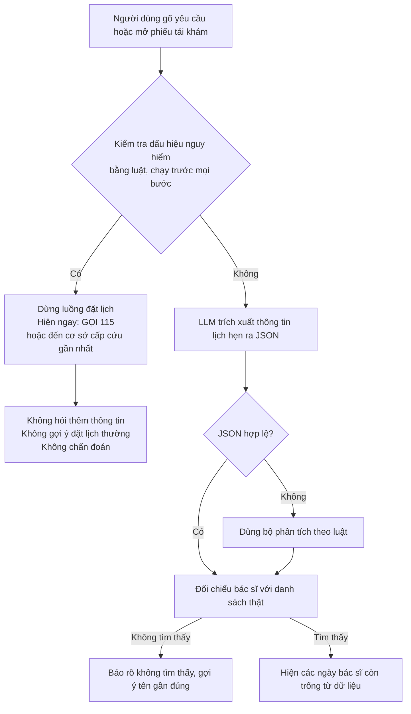

# Đánh giá rủi ro an toàn và đạo đức

| Thông tin tài liệu | |
|---|---|
| Dự án | Vinmec Exploration Sprint · Bài tập 1 tuần |
| Phạm vi | Prototype đặt lịch tái khám (`../05-prototype/`) và các bài học từ chatbot MIA (`../01-phong-van/myvinmec-trial.md`) |
| Phiên bản · Ngày | 1.0 · 19/10/2026 |
| Thuật ngữ | Xem `../THUAT-NGU.md` |

---

## Tóm tắt

Báo cáo dựa trên hai nguồn: 7 rủi ro quan sát được khi kiểm thử MIA (chatbot trong ứng dụng MyVinmec), và 10 rủi ro của prototype, mỗi rủi ro kèm biện pháp giảm thiểu và phần còn hở.

Hai rủi ro cao nhất được xử lý ngay trong thiết kế prototype:

| Rủi ro | Biện pháp |
|---|---|
| Bỏ sót tình huống khẩn cấp | Luật kiểm tra dấu hiệu nguy hiểm chạy trước mọi bước. Khi gặp, app hiện hướng dẫn gọi 115 ngay, không hỏi thêm |
| AI đưa lời khuyên y khoa hoặc bịa thông tin | AI chỉ trích xuất thông tin lịch hẹn theo schema (khuôn dữ liệu cố định). Bác sĩ và lịch trống luôn lấy từ dữ liệu |

---

## 1. Bằng chứng từ kiểm thử MIA

Các rủi ro dưới đây đã quan sát thật. Prototype được thiết kế để tránh lặp lại.

| # | Quan sát trên MIA | Rủi ro | Ảnh (trong `../01-phong-van/screenshots/`) |
|---|---|---|---|
| R-M1 | Câu khẩn cấp (đau ngực, khó thở): MIA bắt điền form giới tính và tuổi trước khi hiện popup gọi 115 | Chậm hành động khi khẩn cấp | `M5.jpg` |
| R-M2 | Câu khẩn cấp bằng tiếng Anh: MIA chỉ đề nghị hỏi lại bằng tiếng Việt, không có hướng dẫn 115 | Người nước ngoài hoặc người gõ không dấu bị bỏ sót | `IMG_4763.jpg` |
| R-M3 | Hỏi chọn khoa cho đau gối: MIA hỏi 5 lượt rồi **liệt kê tên bệnh** (viêm khớp dạng thấp, Gout, nang Baker…) và gợi ý chụp MRI (chụp cộng hưởng từ), dù vừa nói "chưa có đủ cơ sở để phân tích" | Người dùng tự chẩn đoán, lo lắng hoặc trì hoãn đi khám | `M6-1.jpg` đến `M6-4.jpg` |
| R-M4 | Tên bác sĩ không có thật: MIA vẫn hướng dẫn đặt lịch như bình thường | Người nhà nhớ sai tên, đặt nhầm bác sĩ mà không được cảnh báo | `M2.jpg` |
| R-M5 | MIA tự lấy tên thật của người thân trong hồ sơ và đưa vào câu trả lời | Lộ dữ liệu cá nhân khi người dùng chia sẻ màn hình hoặc ảnh chụp | `M1.jpg`, `M2.jpg` (đã che) |
| R-M6 | Mất lịch sử hội thoại, kể cả hướng dẫn 115 | Không xem lại được lời khuyên an toàn đã nhận | `IMG_4762.jpg` |
| R-M7 | App bắt buộc ô "Lý do khám… mô tả rõ triệu chứng" khi đặt lịch | Thu thập dữ liệu sức khỏe nhiều hơn mức cần cho một lịch tái khám | `IMG_4760.jpg` |

## 2. Rủi ro của prototype và cách giảm thiểu

| # | Rủi ro | Mức | Cách giảm thiểu trong prototype | Còn hở |
|---|---|---|---|---|
| 1 | Bỏ sót tình huống khẩn cấp: người nhà gõ "bố đau ngực, đặt lịch giúp" mà hệ thống vẫn đặt lịch thường | Cao | Kiểm tra dấu hiệu nguy hiểm bằng luật từ khóa, **chạy trước mọi bước**, trước cả khi gọi LLM (mô hình ngôn ngữ lớn), và không hỏi gì thêm trước khi hiện nút gọi 115 (học từ R-M1). Từ khóa có cả bản không dấu và tiếng Anh (học từ R-M2). Gặp dấu hiệu nguy hiểm thì dừng luồng đặt lịch | Danh sách từ khóa không phủ hết mọi cách diễn đạt, cần bác sĩ duyệt. Không thay được đánh giá y khoa |
| 2 | AI đưa lời khuyên hoặc chẩn đoán y khoa | Cao | LLM chỉ trích xuất thông tin lịch hẹn (người bệnh, bác sĩ, khoảng ngày) ra JSON. System prompt (phần hướng dẫn cố định cho AI) cấm chẩn đoán và tư vấn. Đầu ra được kiểm tra theo schema, sai thì bỏ (học từ R-M3) | LLM vẫn có thể sinh chữ ngoài schema, đã chặn bằng bước kiểm tra JSON |
| 3 | AI bịa bác sĩ hoặc lịch trống | Cao | Tên bác sĩ được đối chiếu với danh sách (dữ liệu giả). Không tìm thấy thì báo rõ "không tìm thấy bác sĩ này" và gợi ý tên gần đúng (học từ R-M4). Lịch trống chỉ lấy từ dữ liệu, không bao giờ do LLM sinh ra | Khớp tên gần đúng có thể nhầm người trùng tên. Luôn hiện khoa và chức danh để người dùng xác nhận |
| 4 | Gửi dữ liệu cá nhân ra dịch vụ AI bên ngoài | Cao | Prototype chỉ dùng dữ liệu giả. Bản thật không gửi tên, CCCD, BHYT, số điện thoại cho LLM. Chỉ gửi câu yêu cầu đã bỏ định danh, hoặc dùng mô hình chạy trong hạ tầng của bệnh viện | Cần đối chiếu quy định bảo vệ dữ liệu cá nhân hiện hành của Việt Nam (dữ liệu sức khỏe là dữ liệu nhạy cảm) |
| 5 | Đặt hộ khi người bệnh không đồng ý, hoặc người nhà xem được thông tin không nên xem | Trung bình | Prototype ghi rõ "đặt hộ" và gửi thông báo cho cả người đặt lẫn người bệnh, để người bệnh biết có lịch đặt cho mình. Bản thật cần cơ chế đồng ý và thu hồi quyền như NHS App (BP3) | Prototype chưa có bước xin đồng ý thật |
| 6 | Thu thập thừa dữ liệu | Trung bình | Không hỏi triệu chứng khi đặt lịch tái khám, vì lý do khám đã có trong phiếu tái khám của bác sĩ (học từ R-M7) | Không |
| 7 | Bất bình đẳng trong tiếp cận: người lớn tuổi và người không dùng app bị bỏ lại | Trung bình | Thiết kế cho người nhà đặt hộ. Nghiên cứu Fast Pass cho thấy người từ 65 tuổi ít nhận lời mời hơn (OR, tỷ số chênh, 0,86). Bản thật vẫn giữ kênh tổng đài, và lời mời lịch trống gửi cho cả người nhà | Người không có người nhà hỗ trợ vẫn phải dùng tổng đài |
| 8 | Quá tin vào hệ thống: người dùng nghĩ lịch hiện ra là chắc chắn | Thấp | Ghi rõ "prototype, dữ liệu giả, không phải sản phẩm của Vinmec". Bản thật phải gửi xác nhận chính thức sau khi bệnh viện giữ chỗ | Không |
| 9 | Chèn lệnh vào prompt (prompt injection) qua ô gõ tự do | Thấp | LLM không có công cụ, không truy cập dữ liệu, đầu ra chỉ là JSON đã kiểm tra. Lịch và bác sĩ luôn lấy từ dữ liệu | Không |
| 10 | Lộ API key (mã bí mật để gọi dịch vụ AI) | Thấp | Key để trong `.streamlit/secrets.toml` hoặc biến môi trường, file này đã nằm trong `.gitignore`. Không có key thì app chạy chế độ không dùng AI | Không |

## 3. Đường chuyển tuyến khẩn cấp

Bước kiểm tra khẩn cấp là luật chạy ngay trên máy, nên vẫn hoạt động khi không gọi được LLM. Gặp dấu hiệu nguy hiểm, app hiện hướng dẫn gọi 115 ở màn hình đầu tiên, không bắt người dùng điền gì trước.

## 4. Nguyên tắc đạo đức đã áp dụng trong cả bài

| Nguyên tắc | Cách làm |
|---|---|
| Đồng ý | Cả 3 người tham gia đồng ý phỏng vấn và ghi hình trước khi bắt đầu |
| Chỉ hỏi về dịch vụ | Không hỏi chẩn đoán, bệnh án. Thông tin sức khỏe người tham gia tự kể được thay bằng `[đã ẩn]` |
| Ẩn danh | Dùng mã P1–P3. Ghi chép gốc và video để ngoài repo. Tên người thân trong ảnh chụp app đã được che |
| Không tư vấn y khoa | Câu hỏi khẩn cấp khi thử MIA là tình huống giả định, không làm theo lời khuyên của chatbot |
| Không tạo lịch thật | Kiểm thử MyVinmec dừng trước bước xác nhận, không đặt rồi hủy để tránh chiếm chỗ thật |
| Ghi rõ phần do AI tạo | Khai báo tập trung trong `../README.md`, mục "Phần do AI tạo" |
