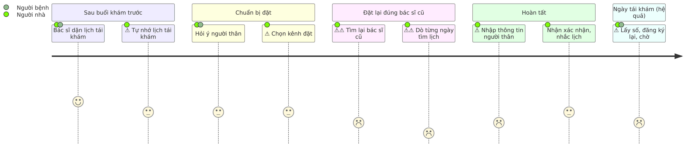
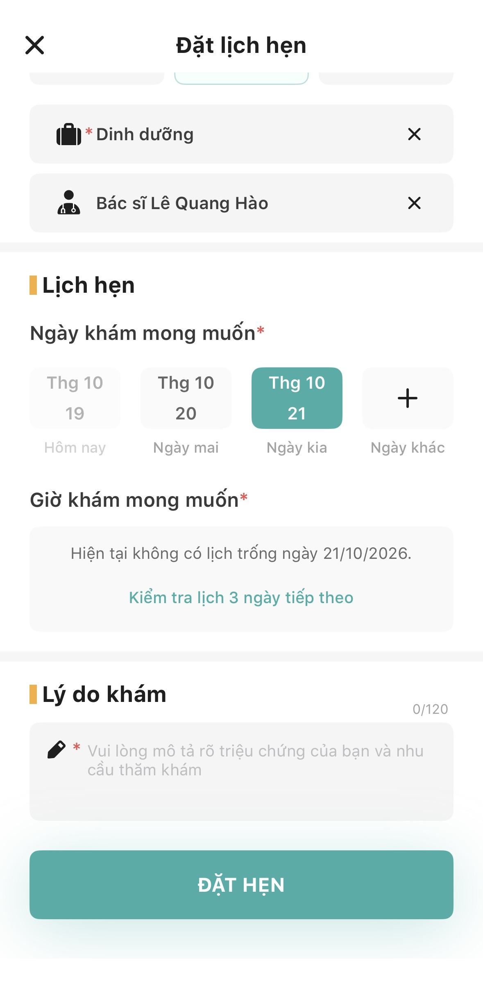
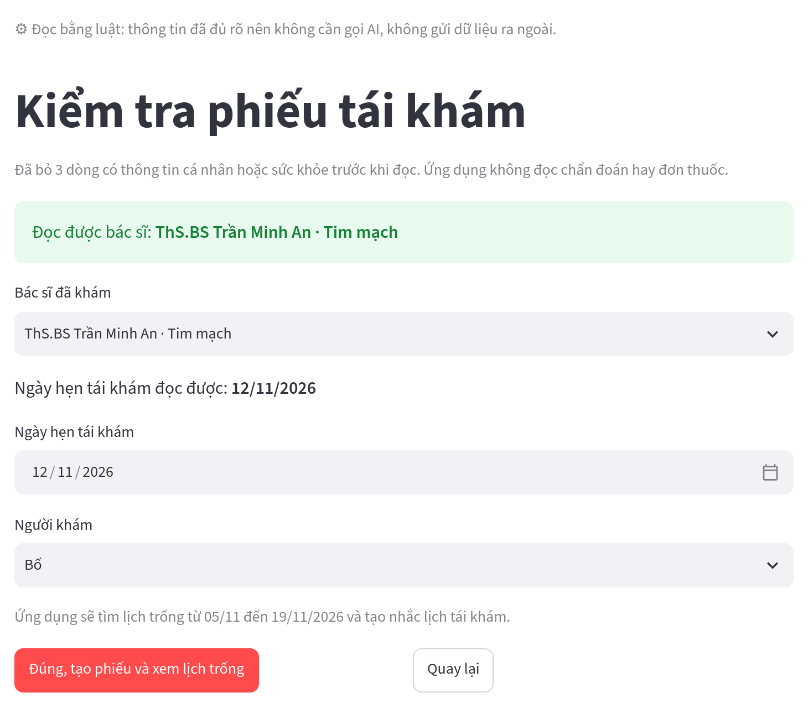
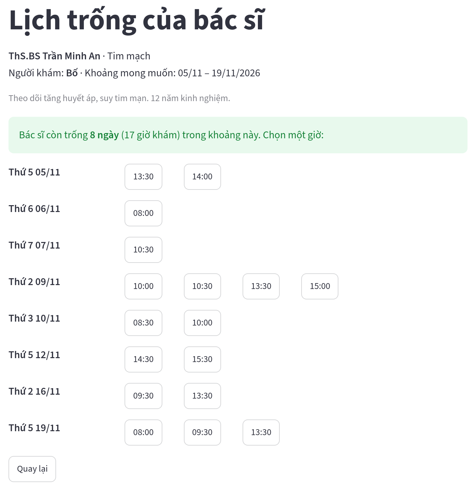

# Đặt lịch tái khám hộ người thân với đúng bác sĩ cũ

**Vinmec Exploration Sprint · Bài tập 1 tuần**

Khoảnh khắc chọn: đặt lịch tái khám, nhìn từ phía người nhà đặt lịch hộ cha mẹ, ông bà

Phần dùng AI (Claude) được khai báo trong README.

<!--
(0:30) Chào anh chị. Bài của tôi tập trung vào một khoảnh khắc hẹp: đặt lịch tái khám, nhìn từ phía người nhà đặt hộ cha mẹ, ông bà.
Tôi dùng Claude để soạn nháp tài liệu và viết mã prototype. Phần phỏng vấn, thử app, chọn điểm đau và need statement là do tôi quyết định. Chi tiết khai báo có trong README.
-->

---

## Phương pháp

| Hoạt động | Quy mô |
|---|---|
| Phỏng vấn ẩn danh qua video call, có đồng ý | 3 người (P1–P3), 13–18 phút mỗi cuộc |
| Dùng thử MyVinmec, dừng trước bước xác nhận | Luồng đặt lịch và hồ sơ bác sĩ |
| Thử MIA (chatbot AI trong MyVinmec) với 9 câu giả định | Có ảnh cho từng câu |
| Tìm và kiểm tra nguồn best practice | 6 nguồn đã mở, ghi ngày truy cập |

Phát hiện bất ngờ: cả 3 lần đặt lịch gần nhất đều là **đặt hộ người thân** (bố, ông nội, mẹ).

<!--
(1:00) Tôi làm 4 việc: phỏng vấn 3 người, tự thử luồng đặt lịch của MyVinmec, thử chatbot MIA với 9 tình huống giả định, và đọc 6 nguồn quốc tế.
Lúc đầu tôi định tìm hiểu việc đặt lịch nói chung. Nhưng điều bất ngờ là cả 3 lần đặt lịch gần nhất đều do người nhà đặt hộ, nên tôi chuyển góc nhìn sang người nhà.
-->

---

## Dữ liệu đã bác bỏ giả thuyết ban đầu

| Giả thuyết ban đầu | Dữ liệu | Kết luận |
|---|---|---|
| Người bệnh khó chọn đúng chuyên khoa | Cả 3 người chấm độ chắc chắn 4/5 | Bác bỏ. Khó ở chọn **bác sĩ** |
| Đặt lịch là khâu khó chịu nhất | Không ai chọn. P1 chấm tái khám 5/5 khó chịu | Bác bỏ. Vấn đề lộ ra ở **tái khám** |
| Người quen dùng app sẽ đặt qua app | P3 quen app 4/5 vẫn gọi điện rồi đến thẳng | Bác bỏ một phần. Kênh phụ thuộc niềm tin |

Insight trọng tâm: người nhà muốn người thân tái khám với đúng bác sĩ cũ, nhưng đây là điều họ ít làm chủ nhất.

> "Không được chủ động lựa chọn lại bác sĩ đã khám… lần đầu" (P1)
> "Thôi mình chọn bác sĩ đầu tiên cho nhanh" (P2)

<!--
(1:15) Dữ liệu bác bỏ giả thuyết ban đầu của tôi. Tôi nghĩ người bệnh khó chọn chuyên khoa, nhưng cả 3 người đều chấm mức chắc chắn 4/5.
Chỗ khó thật nằm ở khâu tái khám: P1 chấm 5/5 khó chịu vì không chọn lại được bác sĩ cũ. P2 không biết bác sĩ nào còn lịch nên chọn đại bác sĩ đầu tiên.
-->

---

## Journey map: cảm xúc thấp nhất ở bước tìm lịch của bác sĩ cũ

| | Sau buổi khám trước | Chuẩn bị đặt | **Đặt lại đúng bác sĩ cũ** | Hoàn tất | Ngày tái khám (ngoài phạm vi) |
|---|---|---|---|---|---|
| Điểm đau | Phải tự nhớ lịch tái khám (D6) | Tin người quen hơn app (D5) | **Không chọn lại được bác sĩ cũ, dò lịch từng ngày (D1)** | Nhập lại giấy tờ, thông báo chỉ về máy người đặt (D2) | Vẫn lấy số, đăng ký lại, chờ (D3, D4) |
| Bằng chứng | P2-1b | P1-10, P2-10 | P1 chấm 5/5 khó chịu, P2-11, ảnh app IMG_4760 | P2-5, P2-6 | P1-7, P2-7, P3-1b |

Bước 5 và 9 dùng điểm người tham gia tự chấm, các bước khác ước lượng từ lời kể.

<!--
(0:45) Journey map có 9 bước. Cảm xúc xuống thấp nhất ở bước tìm lại bác sĩ cũ và tìm lịch trống của bác sĩ đó.
Nói rõ: bước 5 có điểm thật do P1 tự chấm, bước 6 là tôi ước lượng từ lời kể của P2 và lúc tự thử app.
-->

---

## Điểm nghẽn: không thấy bác sĩ cũ còn trống lịch khi nào

| Nguồn | Bằng chứng |
|---|---|
| Phỏng vấn | P1: tái khám 5/5 khó chịu. P2: "không biết ai còn lịch gần" |
| MyVinmec | Phải chọn từng ngày. Ngày kín: "không có lịch trống" |
| MyVinmec | Hồ sơ bác sĩ hiện lỗi kỹ thuật thô |
| Chatbot MIA | Không đưa lịch trống. Từ chối câu hỏi về lịch |

Người nhà còn 3 lựa chọn: dò từng ngày, để tổng đài tự xếp bác sĩ khác, hoặc chọn đại.

<!--
(1:15) Điểm nghẽn có bằng chứng từ cả ba nguồn. Phỏng vấn cho thấy nhu cầu. Khi tự thử MyVinmec, tôi thấy app chỉ cho chọn từng ngày, gặp ngày kín thì báo không có lịch trống. Hỏi MIA thì MIA không trả lời được về lịch.
Kết quả là người nhà phải dò từng ngày, để tổng đài tự xếp bác sĩ khác, hoặc chọn đại.
-->

---

## Need statement

> Cách để **giảm thời gian và số lần thao tác cần thiết để đặt lịch tái khám với đúng bác sĩ đang theo dõi người bệnh**, cho **người nhà đặt lịch hộ người thân** (cha mẹ, ông bà), trong bối cảnh **không biết bác sĩ đó còn trống lịch vào ngày nào, phải dò từng ngày hoặc chấp nhận một bác sĩ khác**.

| Outcome (kết quả mong muốn) đo được | Hiện trạng |
|---|---|
| Số lần chọn ngày tới khi thấy lịch trống đầu tiên của bác sĩ cũ | Chưa đo (giới hạn của bài) |
| Thời gian từ mở app tới màn hình xác nhận | P2 tự kể 10–15 phút, có người hướng dẫn |

Vì sao "đúng bác sĩ" quan trọng: 18/22 nghiên cứu ghi nhận tử vong thấp hơn khi người bệnh được khám liên tục với cùng bác sĩ (tổng quan hệ thống, BMJ Open 2018, gồm các nghiên cứu quan sát)

<!--
(0:45) Need statement không nêu giải pháp: chỉ nói ai, gặp vấn đề gì, và kết quả cần đạt là giảm thời gian và số lần thao tác.
Giới hạn: tôi chưa đo được số liệu nền trên MyVinmec.
Lý do "đúng bác sĩ" quan trọng: tổng quan hệ thống trên BMJ Open cho thấy khám liên tục với cùng bác sĩ liên quan tới tỷ lệ tử vong thấp hơn. Đây là nghiên cứu quan sát, nên chỉ là mối liên quan.
-->

---

## 3 best practice quốc tế và bài học cho Vinmec

| Best practice | Kết quả | Bài học cho Vinmec |
|---|---|---|
| Phiếu tái khám do bác sĩ tạo (Epic MyChart, bệnh viện UC Davis, Mỹ) | 17% lịch tái khám tự đặt online. 1 phút so với 7,2 phút qua điện thoại | Thay lời dặn miệng bằng phiếu gắn sẵn bác sĩ và khoảng ngày |
| Tự động mời nhận lịch trống sớm hơn (Fast Pass, bệnh viện UCSF, Mỹ; nghiên cứu trên tạp chí JMIR 2024) | Khám sớm hơn trung vị 14 ngày. Nhưng chỉ 11% lời mời được nhận, người ≥65 tuổi nhận ít hơn | Hệ thống chủ động báo, và gửi cho cả **người nhà** |
| Truy cập thay mặt người thân (NHS App, ứng dụng y tế công của Anh) | Chưa có số liệu kết quả | Đặt hộ cần người bệnh **đồng ý**, và quyền này thu hồi được |

Không áp dụng nguyên được: cần tích hợp hồ sơ bệnh án và dữ liệu lịch thời gian thực. Việt Nam không có cơ chế đăng ký cố định một phòng khám như Anh.

<!--
(1:15) Ba thực hành quốc tế ứng với ba bước trong journey map: phiếu tái khám do bác sĩ tạo, hệ thống tự mời nhận lịch trống, và quyền đặt hộ có đồng ý.
Nhấn bài học ngược của Fast Pass: chỉ 11% lời mời được nhận, người từ 65 tuổi nhận ít hơn. Vì vậy với Vinmec, lời mời nên gửi cho cả người nhà.
-->

---

## Prototype: đọc giấy hẹn, hiện mọi ngày trống

**Luật (đang chạy):** bỏ dòng họ tên, chẩn đoán, đơn thuốc trên giấy hẹn. Đọc bác sĩ và ngày hẹn theo mẫu quen ("Hẹn ngày 12/11", "tái khám sau 1 tháng"). Kiểm tra khẩn cấp, tìm bác sĩ, rồi **hiện tất cả ngày trống** quanh ngày hẹn.

**AI (đã thiết kế, chưa bật):** đọc những giấy hẹn và câu nói luật không hiểu (viết tắt, "đầu tháng 12"), để có phiếu tái khám mà **Vinmec không cần tính năng mới**. Nguyên tắc: **luật trước, AI sau**. AI không chẩn đoán, không tạo lịch.

**Thử với người dùng:** chưa kịp thử với người dùng thật.

 

Giấy hẹn mẫu GH-1, đọc bằng luật. Trái: kiểm tra phiếu. Phải: mọi ngày trống quanh ngày hẹn 12/11. Chạy bằng Python hoặc Docker.

<!--
(1:30) Demo: bấm giấy hẹn mẫu GH-1, app bỏ 3 dòng thông tin cá nhân, đọc được bác sĩ Trần Minh An và ngày hẹn 12/11, rồi hiện 8 ngày trống quanh ngày hẹn. Tất cả do luật xử lý. Sau đó gõ một câu khẩn cấp để thấy app dừng lại, hiện nút gọi 115.
Nói rõ: bản này chạy bằng luật, chưa bật AI. Luật đọc được giấy hẹn theo mẫu quen (GH-1, GH-2). Giấy viết tắt như GH-3 ("đầu tháng 12") thì luật không đọc được ngày, người nhà phải tự chọn. Đó chính là chỗ AI được thiết kế để dùng. Code đã nối sẵn prompt, khuôn dữ liệu và guardrail, chỉ cần bật khi có API key.
Nếu bị hỏi "sao không bật AI": tôi muốn luật làm trước phần lớn việc, để không gửi dữ liệu y tế ra ngoài khi không cần. AI chỉ dành cho phần luật không làm được. Bước tiếp theo là chạy thử AI trên các giấy hẹn mẫu, đo tỷ lệ đọc đúng so với luật.
Nói thẳng: chưa kịp thử với người dùng thật.
-->

---

## Rủi ro an toàn và biện pháp giảm thiểu

| Quan sát trên MIA (chatbot của MyVinmec) | Prototype xử lý thế nào |
|---|---|
| Câu khẩn cấp: bắt điền giới tính, tuổi trước khi hiện nút gọi 115 | Luật khẩn cấp chạy **trước mọi bước**, không hỏi gì, hiện 115 ngay |
| Câu khẩn cấp bằng tiếng Anh: không có hướng dẫn 115 | Từ khóa có bản không dấu và tiếng Anh |
| Hỏi chọn khoa: liệt kê tên bệnh, gợi ý chụp MRI | AI chỉ được tách thông tin lịch hẹn theo khuôn cố định, bị cấm chẩn đoán |
| Tên bác sĩ không có thật: vẫn hướng dẫn đặt | Đối chiếu danh sách, báo rõ "không tìm thấy" |
| Đưa tên thật người thân vào câu trả lời | Bỏ dòng họ tên, chẩn đoán, đơn thuốc trên giấy hẹn **trước khi đọc**. Luật đọc được thì không gửi gì cho AI |

Đường khẩn cấp: phát hiện dấu hiệu nguy hiểm thì dừng đặt lịch, hiện ngay nút gọi 115, không hỏi thêm, không chẩn đoán.

<!--
(1:00) Mở bằng điểm tốt của MIA: có popup gọi 115 một chạm, có câu lưu ý, không bịa lịch.
Sau đó mới nói chỗ cần cải thiện, và cách prototype xử lý từng chỗ. Rủi ro lớn nhất là bỏ sót tình huống khẩn cấp, nên luật khẩn cấp chạy trước mọi bước.
-->

---

## Kế hoạch coach nhóm K4 và giới hạn

**Coach plan theo Scrum**
- Coach là **Scrum Master** (người điều phối) chung cho 5–10 bạn K4. Mỗi cặp là một Scrum Team, có 1 Product Owner giữ need statement. Khoa và mentor là bên liên quan
- Lịch: sprint 1 tuần (kế hoạch thứ Hai, họp ngắn mỗi sáng, trình bày ở checkpoint thứ Sáu), bám Cổng 1, 2 vòng thử người dùng, Demo Day
- Gỡ kẹt qua câu "đang kẹt gì" mỗi sáng: bài toán quá rộng, phỏng vấn toàn ý kiến, AI bịa nguồn
- Tiêu chí hoàn thành: có bằng chứng, không dữ liệu thật của người bệnh, report 4 phần

**Giới hạn**
- n=3, phỏng vấn ngắn, mẫu là người quen, cả 3 đều đặt hộ
- Chưa ai trong mẫu dùng MyVinmec
- Chưa đo định lượng số lần thử trên app
- Trích dẫn lấy từ ghi chép, chưa đối chiếu nguyên văn với video
- Prototype chưa kịp thử với người dùng thật

**Bước tiếp theo:** thử prototype với 2–3 người nhà có người thân lớn tuổi, bật và đo AI trên giấy hẹn mẫu, đo số liệu nền trên MyVinmec

<!--
(0:45) Với nhóm K4, tôi đóng vai Scrum Master: giữ các mốc của chương trình, thu báo cáo, coach phương pháp, gỡ kẹt. Tôi không làm Product Owner, vì bài toán do khoa và dữ liệu của nhóm quyết định.
Kết thúc bằng giới hạn và bước tiếp theo: đo số liệu nền, thử prototype với người nhà có người thân lớn tuổi. Cảm ơn anh chị.
-->
